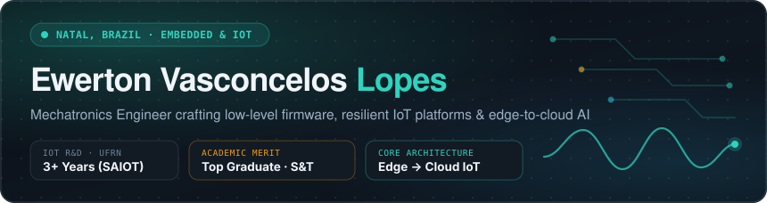
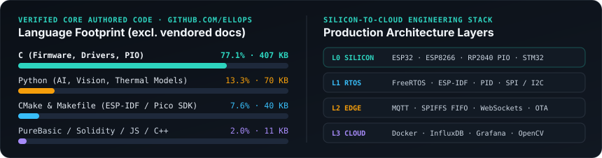

  

  
  
  
  
  

---

### Interactive Engineering Lab — Run My Firmware Logic in the Browser

Instead of static screenshots, my portfolio hosts **live browser simulations modeled directly on the C, ESP-IDF, and RP2040 PIO code in this GitHub account**:

| Simulation | Modeled Repository | What You Can Test Live |
| :--- | :--- | :--- |
| **[01 // PID Reflow Oven Oscilloscope](https://ellops.github.io/?lab=reflow#lab)** | [`Ellops/iotoven`](https://github.com/Ellops/iotoven) | Tune discrete PID gains (`dpid.c` — Ziegler-Nichols & Cohen-Coon presets), switch SAC305 / Sn63 curves, watch 13-bit LEDC PWM, and inject an *"Open Oven Door (-25 °C)"* disturbance. |
| **[02 // Resilient MQTT + SPIFFS Pipeline](https://ellops.github.io/?lab=iot#lab)** | [`Ellops/iotcurrent`](https://github.com/Ellops/iotcurrent) | Adjust SCT-013 AC load, trigger surges, and **cut/restore Wi-Fi** to watch packets buffer into SPIFFS (`/spiffs/offline_records.bin`) and auto-drain in zero-heap JSON batches (`MAX_BATCH_RECORDS = 5`). |
| **[03 // Systems Stack & RP2040 Matrix](https://ellops.github.io/?lab=github#lab)** | [`Ellops/BitDog_C`](https://github.com/Ellops/BitDog_C) & `Ellops/*` | Explore verified code across 5 hardware-to-cloud layers and draw on a live **5×5 WS2812B PIO LED matrix** generating real `BitDog_C` C code & serpentine GRB buffers. |

---

### Selected Embedded, IoT & Applied AI Repositories

| Repository | Stack | Engineering Highlights |
| :--- | :--- | :--- |
| **[`iotcurrent`](https://github.com/Ellops/iotcurrent)** | `C` · `ESP8266 RTOS` · `SPIFFS` · `MQTT` · `Docker` | Battery-powered SCT-013 AC current monitor with deadband ($\Delta I \ge 0.5\text{ A}$) & heartbeat logging, zero-heap stack JSON batching, atomic SPIFFS rollback, Light Sleep (~1.5 mA), OTA, and Mosquitto → Telegraf → InfluxDB v2 → Grafana backend. |
| **[`iotoven`](https://github.com/Ellops/iotoven)** | `C` · `ESP-IDF` · `FreeRTOS` · `Python` | SMD reflow oven retrofit controller featuring 4 Hz FreeRTOS tasks, VSPI 2 MHz thermocouple acquisition, discrete filtered-derivative PID (`N_filter=100`), 13-bit 500 Hz LEDC PWM, and Python thermal modeling. |
| **[`SafePredict`](https://github.com/Ellops/SafePredict)** | `C` · `RP2040` · `PIO` · `LWIP` · `mbedTLS` | Predictive motor monitoring firmware on Raspberry Pi Pico (RP2040) combining MPU6050 vibration, DHT11 PIO capture, current sensing, moving-average filtering, SSD1306 OLED, and Wi-Fi telemetry. |
| **[`BitDog_C`](https://github.com/Ellops/BitDog_C)** | `C` · `RP2040` · `PIO ASM` · `CMake` | Modular Pico-SDK driver suite for BitDogLab hardware, including an 800 kHz WS2812B 5×5 LED matrix PIO state machine (`matrix.c` / `matrix.pio.h`) and SSD1306 I2C display drivers. |
| **[`VisualAttendanceTracker`](https://github.com/Ellops/VisualAttendanceTracker)** | `C` · `ESP32-CAM` · `Python` · `OpenCV` | Ultra-low-cost edge-to-cloud visual attendance tracker pairing an ESP-IDF OV2640 HTTP MJPEG server with a Python HOG 128-D `face_recognition` pipeline and CSV history logging. |
| **[`Esp32Construction`](https://github.com/Ellops/Esp32Construction)** | `C` · `ESP-IDF` · `FreeRTOS` · `SPIFFS` | Core ESP32 Device Creation Library built for the **SAIOT (UFRN)** IoT cloud platform: provisioning, JSON telemetry serialization, clock sync, and local persistence. |
| **[`iotweatherstation`](https://github.com/Ellops/iotweatherstation)** | `C` · `ESP8266` · `MQTT` | Open-source weather telemetry node with custom microsecond bit-banged DHT11 driver, UV & GPS readings, and MQTT publishing. |
| **[`ESP_GAMING`](https://github.com/Ellops/ESP_GAMING)** | `C` · `ESP-IDF` · `SPI` · `I2C` | Embedded graphics & power management experiments featuring ST7735S TFT SPI drivers, JPEG/PNG decoding, and AXP192 I2C PMIC control. |

---

### Codebase & Architecture Footprint

  

---

### Background & Capabilities

- **Research Experience:** IoT Research Developer — **SAIOT Project @ UFRN** *(2021 – 2024)* — Built reusable C/C++ device SDKs, custom IoT hardware nodes, and maintained MQTT / Node.js / React / Docker / MySQL / Redis infrastructure.
- **Education:**
  - **B.Sc. in Mechatronic Engineering** — Federal University of Rio Grande do Norte (UFRN)
  - **B.Sc. in Science and Technology** — UFRN *(2022)* · **Academic Merit Award (Top Graduate of the Period)**
- **Core Toolkit:**
  - **Embedded & Low-Level:** `C`, `C++`, `Assembly`, `ESP-IDF`, `ESP32 / ESP8266`, `RP2040 / PIO`, `STM32`, `ATmega`, `MicroPython`, `Linux Kernel & Drivers`
  - **IoT & Protocols:** `MQTT`, `TCP/IP`, `Modbus`, `WebSockets`, `SPIFFS`, `OTA`
  - **Cloud, AI & Data:** `Python`, `OpenCV`, `Node.js`, `React`, `Docker`, `InfluxDB`, `Grafana`, `MySQL`, `Redis`, `Linux`, `Git`
  - **Engineering & Languages:** Mechanical & Electrical CAD · Portuguese (Native), English (Advanced), Spanish & German (Basic)

---

  Explore the full interactive portfolio at <a href="https://ellops.github.io/">ellops.github.io</a> &middot; Reach out at <a href="mailto:ewerton.va.lopes@gmail.com">ewerton.va.lopes@gmail.com</a>

